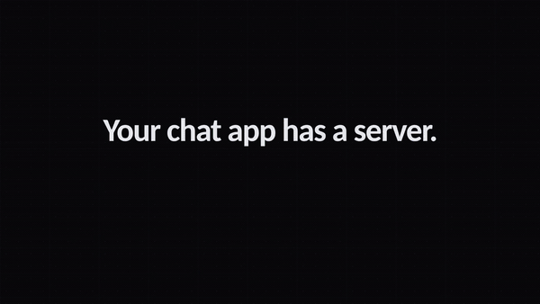

<p align="center">
  
</p>

<h1 align="center">Rascals</h1>

<p align="center">
  <strong>Private, serverless, peer-to-peer chat for desktop.</strong><br/>
  No accounts, no message server, no database — friends connect directly over encrypted WebRTC.
</p>

<p align="center">
  <em>Beta</em> — still testing, bugs to fix. Bug reports welcome, see
  <a href="SECURITY.md">SECURITY.md</a>.
</p>

<p align="center">
  <a href="https://github.com/MinikLover67/Rascals/releases"></a>
  <a href="LICENSE"></a>
  <a href="https://github.com/MinikLover67/Rascals/releases"></a>
  
</p>

<p align="center">
  
</p>

<p align="center">
  <em>20-second demo</em> · <a href="docs/brag.mp4">HD MP4 with sound</a>
</p>

---

## Why Rascals instead of Signal / Discord / Tox?

- **No accounts, no phone number.** You connect with invite codes, not signups.
- **No server in the message path.** Messages go peer-to-peer over WebRTC —
  there is no central database of your conversations to leak, sell or subpoena.
- **Decentralized signaling.** Invite codes work across the internet: different
  Wi-Fi, different cities — if you're both online, you connect.
- **Strict NAT?** Rascals ships with a built-in fallback TURN relay, so calls
  connect out of the box. Prefer zero third parties? Set your own TURN in
  Settings (media stays end-to-end encrypted either way).
- **Signed updates, no tracking.** Every copy polls `latest.json` on this repo
  (daily + on demand in Settings), verifies the minisign signature against a
  baked-in public key, then installs and restarts. No accounts, no tracking —
  just one static file.

## Honest limitations (and what exists today)

Rascals is serverless by design — some trade-offs are permanent, others are on
the roadmap. What you should know before trusting it with anything serious:

**Already handled**

- **Offline messages.** Chats sent to an offline friend are queued locally and
  delivered automatically the moment they come back online (`queued` → `sent`
  → `delivered`). No server needed — but the sender's app must stay running.
- **Background operation.** Closing the window minimizes to the tray; the app
  keeps receiving messages and notifications, including via autostart.
- **Backups.** Profile → "Full backup" exports identity, contacts, servers,
  group keys and chat history as one JSON file; "Restore backup" imports it.
  Keep the file private — it contains your secret key.
- **App lock.** Settings → Security: optional PIN (salted SHA-256, local only)
  required on every start, with escalating cooldown against guessing.
- **Strict NAT / firewalls.** Built-in TURN fallback covers symmetric NAT;
  "Hide my IP" relays everything with zero setup.

**Design trade-offs (inherent to serverless P2P)**

- **Both online for live chat.** Delivery needs the sender's app running until
  the receiver returns; there is no third-party store-and-forward, by design.
- **IP addresses between peers.** WebRTC peers see each other's IP unless you
  enable "Hide my IP" (relay-only). There is no onion routing — yet.
- **Large voice groups.** Voice is a full mesh; every participant uploads to
  everyone. Fine for a handful of people, not for 50.
- **No accounts = no cloud sync.** Use Full backup to move between PCs.

**On the roadmap**

- Mobile apps (iOS/Android) — blocked by WebRTC background limits on iOS.
- Webcam calls: camera video in calls/channels is implemented; multi-party
  video layouts are next.
- Resume of interrupted file transfers (large files re-stream on reconnect
  today, but there is no partial-resume mid-transfer yet).
- Richer server moderation (roles, logs, moderation when the creator is
  offline).
- Independent third-party security audit — today the published self-audit
  ([SECURITY.md](SECURITY.md)) is the reference.

**Windows-only today.** Linux support was dropped (WebKitGTK differences);
macOS is not signed/notarized. Windows SmartScreen may warn on the unsigned
installer — the releases are built by CI from this repo, and the update
signature is what matters. Code-signing certificates are on the roadmap.

## Install on Windows

Download `Rascals_<version>_x64-setup.exe` from
[Releases](https://github.com/MinikLover67/Rascals/releases) and run it.
After the first install, updates arrive inside the app automatically.

## Develop

```bash
npm install
npm run dev        # browser preview (separate storage per browser)
npm run tauri dev  # desktop app (needs Rust + platform webview deps)
npm run build      # frontend build
npm run test       # vitest unit tests (pure protocol/display logic)
npm run lint       # oxlint, must be clean
```

Cut a release: `powershell -NoProfile -ExecutionPolicy Bypass -File scripts/release.ps1 -Version X.Y.Z -Notes "..."`
then publish `release/vX.Y.Z/*` as a GitHub release (see [RELEASE.md](RELEASE.md)).

New contributors: see [CONTRIBUTING.md](CONTRIBUTING.md).

## Support & feedback (beta preview)

Something not working — a friend add that never lands, messages stuck, calls
with no audio? Don't guess: run the built-in **Connection doctor** (Friends
panel, next to "Add friend") for live findings, then use one of these:

- **Self-help page** — [Support (beta)](https://miniklover67.github.io/Rascals/support/):
  pick what's wrong and get targeted fixes, then send structured feedback in
  one click. Also served from [docs/support](docs/support/index.html).
- **[File a bug](https://github.com/MinikLover67/Rascals/issues/new?template=bug_report.yml)** —
  the form asks you to pick what's broken and paste your Connection doctor
  report (no messages, no keys). Ideas go to the
  [feature form](https://github.com/MinikLover67/Rascals/issues/new?template=feature_request.yml).
- **AI-assisted debugging** — register [mcp/rascals-mcp.mjs](mcp/README.md) in any
  MCP-capable assistant, paste your copied report, and get a verdict with fix
  steps (`analyze_rascals_connection`).

Beta feedback is labeled `beta-feedback` — rough reports are welcome.

## Security

See [SECURITY.md](SECURITY.md) for the threat model and the self-audit with
live proof-of-concept exploits. To report an issue, open a GitHub issue —
executable proof beats descriptions. Optional third-party check: services like
[SetRepo](https://setrepo.com) can scan this repo for secrets/dependency CVEs
(not affiliated — untested by us; the built-in self-audit is authoritative).

## License

[MIT](LICENSE) — fork it, ship it, build on it.
